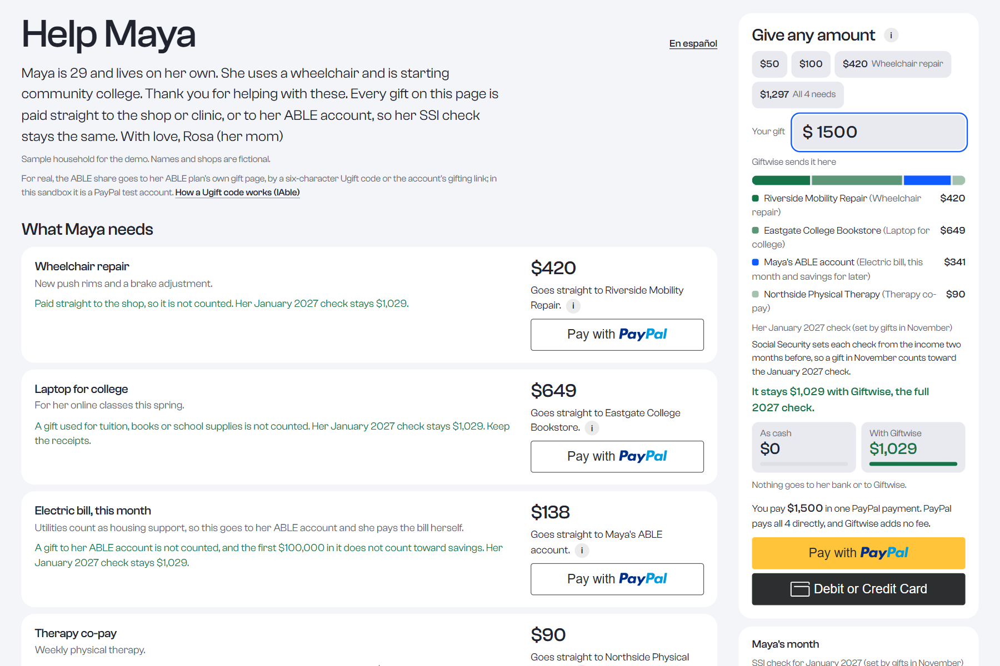
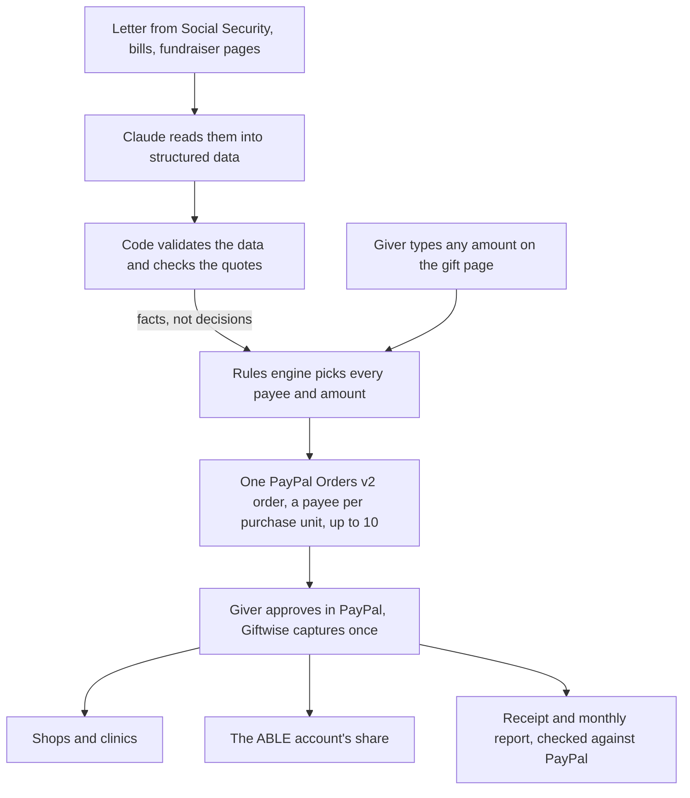

# Giftwise

Benefit-safe giving for people on SSI, their families and their benefits counselors. Family and friends give through PayPal, which pays the shops and clinics directly; the share for the person's ABLE account goes through the ABLE plan's own gift page. The monthly check stays whole.

- **Live site:** [giftwise-405i.onrender.com](https://giftwise-405i.onrender.com), on PayPal's sandbox, no sign-up
- **Demo video (3 min):** [youtu.be/L4s_d4p7Td8](https://youtu.be/L4s_d4p7Td8)
- **Start here:** [the five-minute path](https://giftwise-405i.onrender.com/evidence#path), or [make a payment in three minutes](#test-it)

## The problem

SSI (Supplemental Security Income) is Social Security's monthly payment to people who are blind, disabled or 65 or older, with little income and under $2,000 in savings. A cash gift counts as income and lowers the check paid two months later.

Give Maya (a sample person) $1,000 in cash in November 2026 and her January 2027 check drops from $1,029 to $109; kept, the $1,000 also takes her savings to $2,240 on December 1, over the $2,000 limit. Pay the shop for something she needs and the same $1,000 leaves that January 2027 check at $1,029 ([20 CFR 416.1121](https://www.ecfr.gov/current/title-20/chapter-III/part-416/subpart-K/section-416.1121), [POMS SI 00830.520](https://secure.ssa.gov/poms.nsf/lnx/0500830520)).

Paying the landlord is not safe either: $800 of rent paid by family in November 2026 leaves her January 2027 check at $686 of $1,029, and through ABLE it stays $1,029. An ABLE account holds savings SSI does not count ([POMS SI 01130.740](https://secure.ssa.gov/poms.nsf/lnx/0501130740)).

## What it does

1. **A family member or benefits counselor makes a gift page** on `/start`; Claude can read the person's situation from their letter from Social Security, and the needs from a fundraiser page.
2. **A giver types any amount.** The rules engine splits it and picks each payee: shops and clinics directly, housing and savings through the ABLE account.
3. **The giver pays once,** with PayPal or a card. One PayPal order pays every payee, captured once; nothing goes to her bank account or to Giftwise.
4. **Everyone gets a record:** a receipt with each PayPal capture ID, and the month's report to Social Security, also in Easy Read, that anyone can check against PayPal.

Also built: monthly gifts, PayPal Payouts for funds, and an MCP server for AI assistants.



## How it works



- **The rules engine decides the money:** plain code built from the regulations and SSA's manual, every rule citing its source ([`engine.ts`](src/lib/rules/engine.ts), also on npm as [`ssi-gift-rules`](https://www.npmjs.com/package/ssi-gift-rules)).
- **Claude reads; it never decides money.** For a possible housing bill, two Claude reviewers quote two rulebooks (20 CFR 416 and SSA's POMS) word for word; code checks every quote, and unless both agree, a referee in code takes the route that keeps the check whole either way ([`referee.ts`](src/lib/review/referee.ts)).
- In the sandbox a PayPal test account stands in for the ABLE account; for real, that share goes through the plan's own gift page ([docs/real-world.md](docs/real-world.md)).

## Built with

| PayPal | In Giftwise | Code |
|---|---|---|
| Orders v2 | One order per gift, a payee per purchase unit, up to 10, created with the PayPal Server SDK | [`gift-order.ts`](src/lib/paypal/gift-order.ts) |
| JavaScript SDK v6 | PayPal buttons and the guest card button | [`PayPalPay.tsx`](src/components/gift/PayPalPay.tsx) |
| Capture | Server side, once, under one `PayPal-Request-Id` | [`capture.ts`](src/lib/paypal/capture.ts) |
| Payouts, Transaction Search, Balances | A fund pays many households in one batch, each payout confirmed in PayPal's report | [`payouts.ts`](src/lib/paypal/payouts.ts) |
| Webhooks | Captures a payment whose giver never came back, signature verified | [`webhook`](src/app/api/paypal/webhook/route.ts) |
| PayPal MCP server | The AI assistant reads each checkout back with `get_order` | [`paypal-mcp.ts`](src/lib/agent/paypal-mcp.ts) |

**AI**

- **Claude (`claude-opus-5-5`)** reads letters, bills and fundraiser pages into checked data and acts as the two reviewers. With no key, or the day's AI budget spent, samples replay its recorded answers, labelled Replayed ([`src/lib/ai`](src/lib/ai)).
- **Ask the rulebook** on `/learn`: Elasticsearch finds the passages, Claude answers only from them, and code checks each quote.
- **The Giftwise MCP server** at `/api/mcp`, with nine tools, from checking a gift to starting a checkout ([`tools.ts`](src/lib/mcp/tools.ts)).

| Tool | In Giftwise |
|---|---|
| AG Studio | `/dashboard`: her year of gifts and checks, a widget that runs the rules engine, and an AI assistant on Claude |
| APIMatic | Generated the PayPal Server SDK that creates every order |
| Bryntum Calendar | `/g/maya/calendar`: drag a gift to another day and see which checks change |
| Channel3 | The gift finder: real products, each checked against the rules first |
| Elastic | Ask the rulebook: hybrid search with `jina-embeddings-v3`, reranked by `jina-reranker-v3` |
| KERNEL | A cloud browser that reads fundraiser pages that need JavaScript; with no key, a plain fetch ([`kernel.ts`](src/lib/sponsors/kernel.ts)) |
| Postman | The API as a collection in [`postman/`](postman/), run in the tests with Newman |
| Render | Hosts the app and Postgres; a Render Workflow runs 25 outside checks on the live site nightly and plans monthly gifts |
| Zapier | Each capture sends the organizer a signed `gift.received` webhook, such as a Zapier Catch Hook |

The other tools' jobs and files, and their fallbacks with no key: [`/stack`](https://giftwise-405i.onrender.com/stack).

## Why it matters

- **7.4 million** people received SSI in January 2025 ([CRS IF10482](https://www.congress.gov/crs-product/IF10482)).
- **454,843** had their check lowered in December 2024 for help with shelter, by $247 a month on average ([SSI Annual Statistical Report 2024](https://www.ssa.gov/policy/docs/statcomps/ssi_asr/2024/sect02.html), Tables 8 and 12).
- **8.59 percent** of SSI improper payments in fiscal years 2020 to 2024 came from food or shelter given by others ([SSA FY 2025 Agency Financial Report](https://www.ssa.gov/finance/2025/Other%20Reporting%20Requirements.pdf), pages 184 and 186).
- **83,110** people had payments suspended in 2024 for savings over the $2,000 limit ([SSI Annual Statistical Report 2024](https://www.ssa.gov/policy/docs/statcomps/ssi_asr/2024/sect11.html), Tables 76 and 77).
- **263,000** ABLE accounts were open on June 30, 2026 ([ISS Market Intelligence](https://www.529conference.com/2q-2026-529-and-able-market-sizing-highlights/)), against roughly 14 million people who can open one ([ABLE National Resource Center](https://www.ablenrc.org/achievable-newsletter-june-2026-issue/)).

More, with sources: [docs/real-world.md](docs/real-world.md#what-is-at-stake-measured-by-social-security).

## Results

- **40 of 40** of Social Security's own worked examples match SSA's answer; Claude with no rulebook, 32 of 40 ([`/evidence/ssa-examples`](https://giftwise-405i.onrender.com/evidence/ssa-examples)).
- **14 of 14 scored, of 36 cases:** every federal court case that turns on whether a gift counts reaches SSA's and the court's outcome; the other 22 turn on loans, shared rent, trusts or remands ([`/evidence/court-cases`](https://giftwise-405i.onrender.com/evidence/court-cases)).
- **0 of 55** gifts that would lower the check were let through; **6 of 51** fine gifts were sent another way, her check still whole ([`/evidence/rules#errors`](https://giftwise-405i.onrender.com/evidence/rules#errors)).
- **22 of 28 bills settled by the two AI reviewers, against 0 of 28 with no AI,** her check whole on 59 of 59 bills either way. On five adversarial cases, the referee keeps it whole on 5 of 5 and the manual reviewer alone on 4 of 5 ([docs/results.md](docs/results.md#what-the-ai-adds-measured)).
- **$331 to $663 a month.** Family help was counted against the person in all 14 scored court cases; routed through Giftwise, it keeps money in 4, and in 10 with an ABLE account. The engine's counterfactual at 2026 rates, not an observed outcome ([`/evidence/impact#kept`](https://giftwise-405i.onrender.com/evidence/impact#kept)).
- **100,000 random gifts** each keep all thirteen promises, such as every cent placed and her check whole ([`/evidence/rules#invariants`](https://giftwise-405i.onrender.com/evidence/rules#invariants)).

## Test it

About three minutes on the live site. PayPal's sandbox moves no real money.

1. Open [`/g/maya`](https://giftwise-405i.onrender.com/g/maya). If a need shows as paid, press **Reset the sample page** under **Testing in the sandbox**.
2. In **Give any amount**, type `1500`: four payees ($420, $649, $341 to her ABLE account, $90), and her check two months later stays $1,029 (the 2027 amount); as cash it would be $0.
3. Press the PayPal button, log in as the shared sandbox buyer (please leave the password as it is) and press **Complete Purchase**.
   - Email: `sb-tvnmx53636325@personal.example.com`
   - Password: `D.}t1I^T`

   Or choose **Debit or Credit Card**: test card `4012 8888 8888 1881`, any future date, any CVV.
4. **See the receipt** lists each payee's PayPal capture ID; **Check with PayPal now** asks PayPal live.
5. To see Claude read a document: on [`/start`](https://giftwise-405i.onrender.com/start), type a name, press **Next**, then **Use the sample letter** (made up for the demo); code checks each quote against the PDF.

Every other flow, step by step: [TESTING.md](TESTING.md).

## Run it yourself

You need Node.js 22 or newer, Docker, a PayPal sandbox app and an Anthropic API key.

```bash
npm install
docker compose up -d          # Postgres 17
cp .env.example .env.local    # add PayPal sandbox keys, payee accounts and ANTHROPIC_API_KEY
npm run db:push               # create the tables
npm run dev -- -p 3100        # http://localhost:3100; Maya's page is created when /g/maya first opens

npm test                      # no keys needed: a fresh clone runs 462 pass and 10 skip (10 need a database)
npm run typecheck && npm run lint
```

No test calls Claude or PayPal. [TESTING.md](TESTING.md#run-the-tests) lists every suite, including the end-to-end ones that need a running server and sandbox keys. [](https://github.com/usv240/giftwise/actions/workflows/ci.yml) runs on every push.

## Read more

- [docs/results.md](docs/results.md): every result in depth, with four held-out sets of SSA examples
- [docs/real-world.md](docs/real-world.md): real money, who it reaches, a first pilot
- [docs/inside.md](docs/inside.md): what the AI never decides, the design research, every feature
- [docs/evidence-index.md](docs/evidence-index.md): ten claims, each with its live page, code and test
- [docs/tests.md](docs/tests.md): every test suite and its recorded count

## License

[MIT](LICENSE). Maya, her family and the shops are fictional. Photographs and video are credited in [`public/images/credits.json`](public/images/credits.json) and [`public/media/credits.json`](public/media/credits.json).
