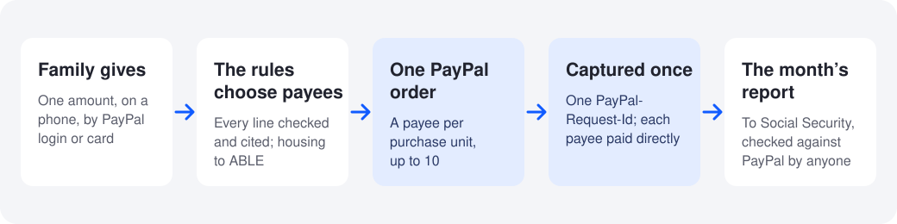

# Giftwise

Benefit-safe giving for people on SSI, their families and their benefits counselors. Family and friends give through PayPal, which pays the shops and clinics directly; the share for the person's ABLE account goes through the ABLE plan's own gift page. The monthly check stays whole.

- **Live:** [giftwise-405i.onrender.com](https://giftwise-405i.onrender.com), PayPal sandbox, no login. The sandbox buyer login is in [TESTING.md](TESTING.md).
- **Start here:** [the five-minute path](https://giftwise-405i.onrender.com/evidence#path), the home page's **See it work in five minutes**. Its first step is the home page's Gift Checker: $1,000 as cash, then **Pay the shop**.
- **Claims to evidence:** [docs/evidence-index.md](docs/evidence-index.md): ten claims, each with the live page, the file and line, and the test.



## Results

- **$331 to $663 a month.** Help from family was counted against the person in all 14 real SSI court cases scored; routed through Giftwise, the same help keeps money in 4 as the opinions state the facts, and in 6 more, 10 in all, when the person can open an ABLE account. These are the rules engine's counterfactuals at 2026 rates, not outcomes anyone saw ([`/evidence/impact#kept`](https://giftwise-405i.onrender.com/evidence/impact#kept)).
- **14 of 14 scored, of 36 cases:** of 36 federal court cases about help from others, 14 turn on whether a gift counts, and the engine reaches the outcome SSA and the court did in all 14; the other 22 turn on a loan, shared rent, a trust or a remand ([`/evidence/court-cases`](https://giftwise-405i.onrender.com/evidence/court-cases)).
- **0 of 3** in a second class of court cases, where the court held the help was not income, on the first run, before the engine had a loan field: each is a loan. With each court's finding in the new loan field, 3 of 3, after the fix ([`/evidence/court-cases#not-income`](https://giftwise-405i.onrender.com/evidence/court-cases#not-income)).
- **40 of 40** of Social Security's own worked examples match SSA's answer; Claude with no rulebook matches 32 of 40 ([`/evidence/ssa-examples`](https://giftwise-405i.onrender.com/evidence/ssa-examples)).
- **20 groups** of SSA's examples are listed apart and not scored, each with its reason in `content/eval/ssa-examples.json`: they turn on something other than a gift to one person, or on a rule the engine added later, which the held-out sets then tested.
- **Four held-out sets of SSA examples, each run once on a frozen engine: 4 of 5, 1 of 5, 1 of 5 and 6 of 15.** The first ran at commit `3f3ea60`; its first run matched 1 of 5, and two expected answers were then corrected to SSA's text, with reasons in `content/eval/held-out.json`. The others were written before their run: `content/eval/held-out-2.json` (git blob `715607f`, frozen at `c5e94eb`), `content/eval/held-out-3.json` (git blob `b9a5ece`, frozen at `7e24ed8`, 5 of 5 on whether the gift counts) and `content/eval/held-out-4.json` (git blob `49ba930`, frozen at `201128b`, 7 of 15 on whether the help counts). The rules they showed are now in the engine ([docs/results.md](docs/results.md)).
- **0 of 55** gifts that would lower the check were let through, over every case whose right answer is known ([`/evidence/rules#errors`](https://giftwise-405i.onrender.com/evidence/rules#errors)).
- **6 of 51** fine gifts were sent another way, each with her check whole (`src/lib/error-rates.ts`).
- **59 of 59 labeled bills** were routed so the check stays whole, 52 clear and 7 contested; Claude with no rulebook, 56 of 59.
- **100,000 random gifts** each keep all thirteen promises: every cent placed, her check whole, ABLE within its limit.
- **The ABLE share, for real.** PayPal carries 56 percent of the sample year's dollars today: $3,519 of $6,328, everything paid to shops and clinics. The ABLE share goes through the plan's own gift page; in the sandbox a PayPal test account stands in ([docs/real-world.md](docs/real-world.md)).

Case by case: [docs/results.md](docs/results.md), [`/evidence/rules`](https://giftwise-405i.onrender.com/evidence/rules).

## What the AI adds

Two Claude reviewers read a bill, one against the regulations and one against SSA's manual; a referee in code acts only when both quotes check out and agree. On the 59 recorded bills a router with no AI keeps her check whole on 59 of 59 with 0 wrong routes, as the referee does; what the reviewers add is settling bills, 22 of the 28 that are not housing paid straight to the business, against 0 of 28 with no AI. On the five adversarial cases in `src/lib/review/adversarial.ts`, where one reviewer would mislead the router, the referee keeps her check whole on 5 of 5 and the manual reviewer alone on 4 of 5 ([docs/results.md](docs/results.md#what-the-ai-adds-measured)).

## Run it yourself

```bash
npm install
docker compose up -d          # Postgres 17
cp .env.example .env.local    # PayPal sandbox keys, payee accounts, ANTHROPIC_API_KEY, DATABASE_URL (TESTING.md names each)
npm run db:push               # create the tables; Maya's sample page is seeded the first time /g/maya opens
npm run dev -- -p 3100        # http://localhost:3100
npm test                      # a fresh clone with no .env.local: 436 pass and 7 skip (7 need a database); when .env.local names a reachable database: 443 of 443, no keys needed
```

`npm test` needs no keys: tests that need Postgres skip with the reason in their names; no test calls Claude or PayPal. [TESTING.md](TESTING.md) explains every variable and suite; `npm run checks:local` runs the same 25 outside checks as the nightly Render Workflow ([`render.yaml`](render.yaml)).

[](https://github.com/usv240/giftwise/actions/workflows/ci.yml) on every push: audit, types, lint, unit tests, 20,000 fresh random gifts, the `ssi-gift-rules` package and a keyless production build checked with axe. [](https://github.com/usv240/giftwise/actions/workflows/e2e-paypal.yml) on demand, in the sandbox.

## Where to look

| | Open | Then run |
|---|---|---|
| PayPal | [`src/lib/paypal/gift-order.ts`](src/lib/paypal/gift-order.ts), a payee per purchase unit; [`src/lib/paypal/capture.ts`](src/lib/paypal/capture.ts), captured once | `npm run e2e:api`, 119 of 119; `npm run e2e:paypal`, 14 of 14 (sandbox keys), with redacted transcripts ([`/evidence/operations#transcripts`](https://giftwise-405i.onrender.com/evidence/operations#transcripts)) |
| The product | [`/g/maya`](https://giftwise-405i.onrender.com/g/maya), [the month's report](https://giftwise-405i.onrender.com/g/maya/report?month=2026-10), the [organizer's page](https://giftwise-405i.onrender.com/manage/maya-sample-organizer) | `npm run e2e:ui`, 66 of 66 (Claude's four document steps run live with a key and on its recorded answers without one, and skip only when the server has no AI key and no recorded answers); `npm run e2e:a11y`, 140 of 140 page views |
| Who it helps | [`src/lib/impact.ts`](src/lib/impact.ts), [`src/lib/research.ts`](src/lib/research.ts), [`/evidence/impact`](https://giftwise-405i.onrender.com/evidence/impact) | `tests/docs-numbers.test.ts`; `tests/research.test.ts` |

## PayPal and AI, file by file

| | Here | File |
|---|---|---|
| Orders v2 | One order, a purchase unit and payee per recipient, up to 10, payees from the server, created through the Server SDK and read over REST. Real shops are paid by `payee.merchant_id` after Partner Referrals onboarding, which PayPal opens to approved partners ([docs/real-world.md](docs/real-world.md)) | `src/lib/paypal/gift-order.ts`, `src/lib/paypal/orders.ts` |
| JavaScript SDK v6 | The PayPal button on each need and on Give any amount, and the guest card button | `src/components/gift/PayPalPay.tsx` |
| Capture | Server side, once, under one `PayPal-Request-Id`; a 5xx retried with the same id | `src/lib/paypal/capture.ts` |
| Approval links | An assistant or a monthly gift starts an order; only the giver approves; Giftwise captures on return | `src/lib/paypal/gift-order.ts`, `src/app/api/paypal/return/` |
| Payouts, Transaction Search, Balances | A fund pays many households' needs in one batch, each confirmed in PayPal's report | `src/lib/paypal/payouts.ts`, `src/lib/paypal/reporting.ts` |
| Webhooks | Captures a payment the giver never returned for, after checking PayPal's signature | `src/app/api/paypal/webhook/route.ts` |
| PayPal MCP server | The assistant reads each checkout back through `get_order`; Giftwise's MCP server at `/api/mcp`, with nine tools, starts a checkout only the giver can approve | `src/lib/agent/paypal-mcp.ts`, `src/lib/mcp/tools.ts` |
| Claude | Reads bills and fundraiser pages into checked data and acts as two reviewers; it never decides money. With no key or the budget spent, the samples replay its recorded answers, labelled Replayed | `src/lib/ai/tasks.ts`, `src/lib/ai/bill-review.ts`, `src/lib/ai/claude.ts` (`content/ai-replay`), `src/lib/rules/engine.ts` |
| AG Studio, Bryntum, Channel3, KERNEL, Elasticsearch, Federal Register, Postman, Zapier, Render Workflows, Sentry | Each with its job and file on [`/stack`](https://giftwise-405i.onrender.com/stack) | [docs/inside.md](docs/inside.md) |

Every commit is from November 2026 (`git log --date=short`).

## What it changes, in dollars

- In the two real court cases whose opinions state how long the help lasted, the same help routed through Giftwise would have kept one family $13,584.53 over 41 months and another $24,518.79 over 37 months, $38,103.32 in all, at 2026 rates. The rules engine's counterfactual on each case's own facts: what it keeps each month ($331.33 and $662.67), repriced at 2026 rates, times the months the opinion states.
- In Maya's sample year, one shared page keeps $1,747.33 that 10 of her monthly checks would lose with each giver paying on their own.
- Paying a shop, a clinic or a school keeps the check whole for all 7.4 million people on SSI (January 2025, [CRS IF10482](https://www.congress.gov/crs-product/IF10482)). Rent and utilities stay whole through an ABLE account, open where blindness or a disability began before 46 ([POMS SI 01130.740](https://secure.ssa.gov/poms.nsf/lnx/0501130740)), all 1.0 million children on SSI among them. Without ABLE, $800 of rent paid by family in November 2026 leaves her January 2027 check at $686 of $1,029, and through ABLE it stays $1,029 (`housingReach()` in [`src/lib/impact.ts`](src/lib/impact.ts)).

Computed by [`src/lib/impact.ts`](src/lib/impact.ts), the code the site uses ([`/evidence/impact`](https://giftwise-405i.onrender.com/evidence/impact)).

## What is at stake

SSI counts cash gifts as income, and a gift sets the check paid two months later, at that year's federal amount: $994 in 2026, $1,029 from January 2027. Give Maya $1,000 in cash in November 2026 and her January 2027 check drops from $1,029 to $109, and the same call to `POST /api/v1/check-gift` flags her savings: kept, the $1,000 takes her savings to $2,240 on December 1, over the $2,000 limit (`resources_after_gift`). Pay the shop for something she needs and the same $1,000 leaves that January 2027 check at $1,029 ([20 CFR 416.1121](https://www.ecfr.gov/current/title-20/chapter-III/part-416/subpart-K/section-416.1121), [POMS SI 00830.520](https://secure.ssa.gov/poms.nsf/lnx/0500830520)).

Measured by the agency itself ([`/evidence/impact#stake`](https://giftwise-405i.onrender.com/evidence/impact#stake); `src/lib/research.ts`, `tests/research.test.ts`):

- **454,843** people on SSI had their check lowered in December 2024 for shelter someone else helped with, by $247 a month on average ([SSI Annual Statistical Report 2024](https://www.ssa.gov/policy/docs/statcomps/ssi_asr/2024/sect02.html), Tables 8 and 12; [88 FR 9779](https://www.govinfo.gov/content/pkg/FR-2023-02-15/html/2023-02731.htm)).
- **8.59 percent** of SSI improper payments in fiscal years 2020 through 2024 came from in-kind support, $1.5 billion paid too much and $1.3 billion too little; ([FY 2025 Agency Financial Report](https://www.ssa.gov/finance/2025/Other%20Reporting%20Requirements.pdf), pages 184 and 186). SSA told its Inspector General it has no tools to identify living arrangement errors ([OIG 152601](https://oig.ssa.gov/~assets/uploads/152601.pdf), July 2026), and attributed 9 percent of the SSI overpayments assessed in 2020 through 2023 to unreported living arrangements or in-kind support ([OIG 062405](https://oig.ssa.gov/~assets/uploads/062405.pdf), February 2025).
- **$132 a month** is SSA's own pricing of housing help from others, the average rise it projected for about 41,000 people under its 2024 rental subsidy rule ([89 FR 25507](https://www.govinfo.gov/content/pkg/FR-2024-04-11/html/2024-07675.htm)).
- **83,110** people had payments suspended in 2024 for savings over a $2,000 limit unchanged since 1989, and 45,146 had them ended ([SSI Annual Statistical Report 2024](https://www.ssa.gov/policy/docs/statcomps/ssi_asr/2024/sect11.html), Tables 76 and 77; [POMS SI 01110.003](https://secure.ssa.gov/poms.nsf/lnx/0501110003)). **263,000** ABLE accounts held $3.6 billion on June 30, 2026, against roughly 14 million people who can open one since the age limit rose to 46 ([ISS Market Intelligence](https://www.529conference.com/2q-2026-529-and-able-market-sizing-highlights/); [POMS SI 01130.740](https://secure.ssa.gov/poms.nsf/lnx/0501130740)).
- **10 percent** of the check is the rate at which an SSI overpayment is recovered ([EM-25029 REV](https://secure.ssa.gov/apps10/reference.nsf/links/08282025031929PM)), so the $4,870.00 and $11,442.20 asked back in two court cases would take 49 and 116 months to repay.

## Design

On a phone, the total and payees sit beside the PayPal button. The person on SSI gets her report in Easy Read and Spanish (`tests/easy-read.test.ts`, `tests/gift-es.test.ts`). 140 of 140 page views pass axe (WCAG 2.2 AA), phone and desktop, light and dark. Light is the default; dark and Large text are one tap away ([`/evidence`](https://giftwise-405i.onrender.com/evidence#design), [docs/inside.md](docs/inside.md)).

## What is first here

Of the products compared on [`/evidence/impact#compare`](https://giftwise-405i.onrender.com/evidence/impact#compare), each from its own dated page, none does these three or publishes accuracy against SSA's own material:

- **A third party's gift is routed by a rules engine built from the statute to the payee before it becomes the person's money**, and one PayPal order pays up to ten payees.
- **A monthly report to Social Security anyone can verify against PayPal's records, with no login.**
- **Two reviewers reading two different rulebooks (20 CFR 416 and POMS), quotes checked by code, and a referee that keeps the check whole under either reading when they disagree.** Its lineage is on [`/evidence/rules#lineage`](https://giftwise-405i.onrender.com/evidence/rules#lineage) (`src/lib/review/referee.ts`).

## See it

| One checkout, four payees | The same gifts, as cash |
|---|---|
|  |  |

## Sources and credits

More: [docs/results.md](docs/results.md), [docs/real-world.md](docs/real-world.md) (real money, who it reaches, a first pilot), [docs/inside.md](docs/inside.md) (what the AI never decides, every feature), [docs/tests.md](docs/tests.md). Photographs and video are from open collections, credited in [`public/images/credits.json`](public/images/credits.json) and [`public/media/credits.json`](public/media/credits.json). Maya, her family and the shops are fictional. [MIT license](LICENSE).
