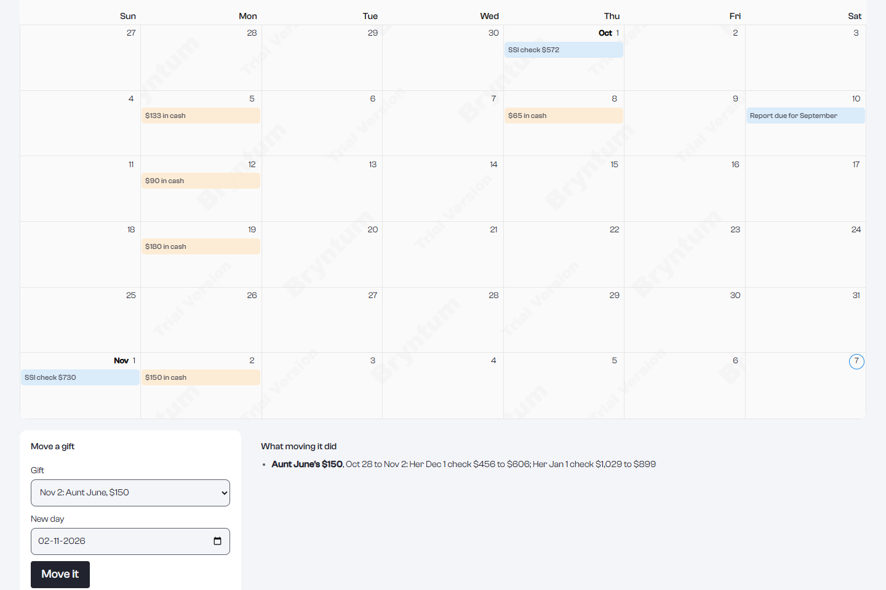
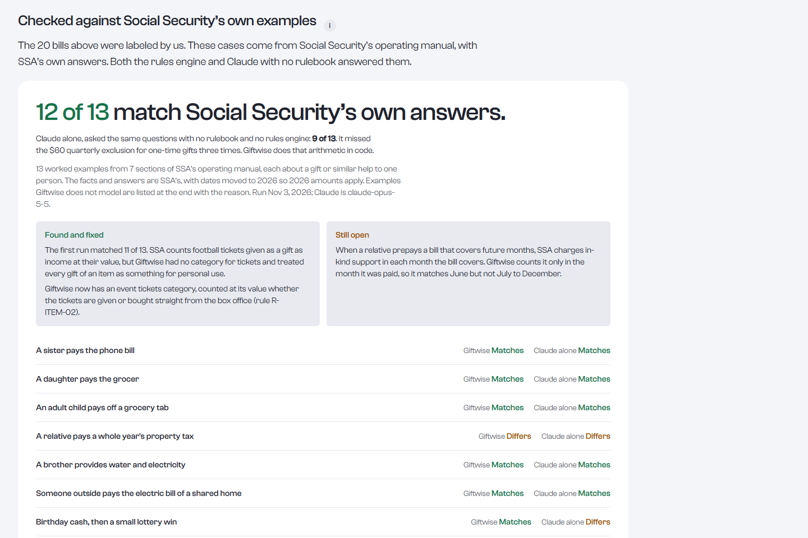
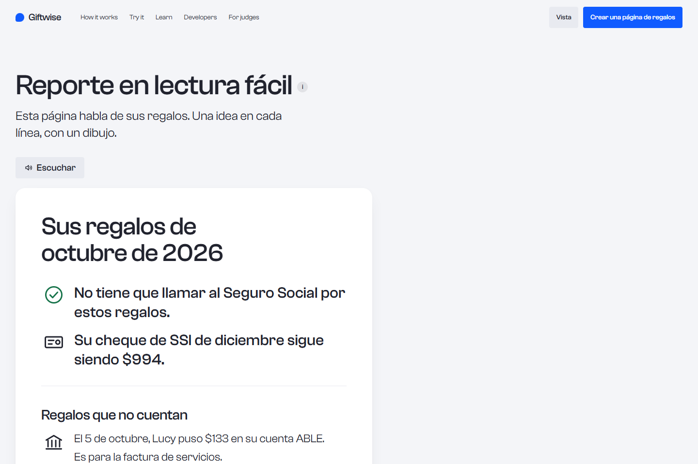
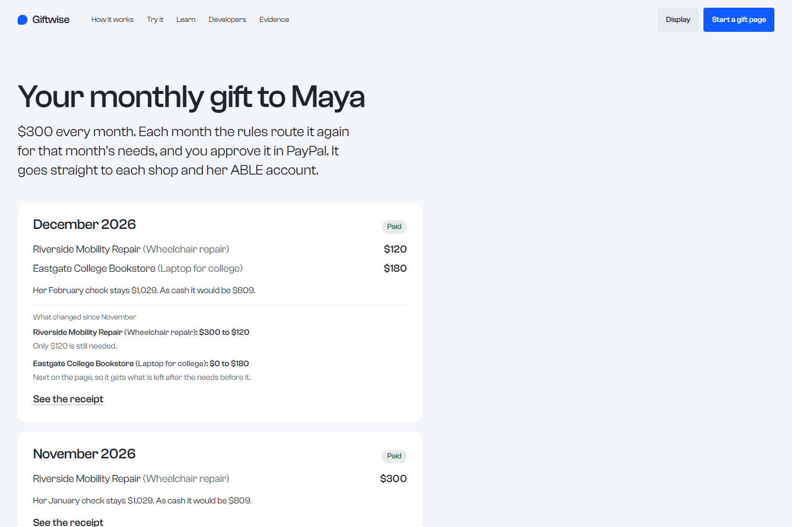
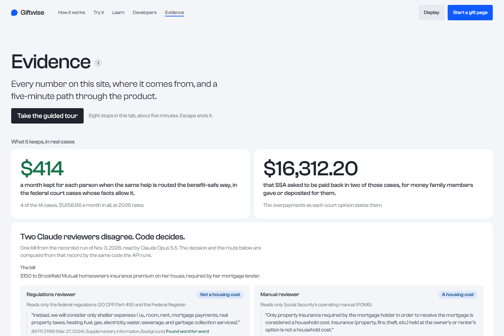
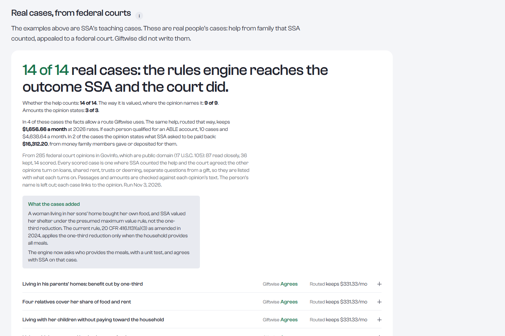

# Giftwise

[](https://github.com/usv240/giftwise/actions/workflows/ci.yml)

Benefit-safe giving for people on SSI. Family and friends give through PayPal, and Giftwise pays the shop, the clinic or the person's ABLE account directly, so the monthly check stays whole.

- **Live demo:** [giftwise-405i.onrender.com](https://giftwise-405i.onrender.com) (PayPal sandbox, no Giftwise login needed)
- **For judges:** start at [`/judges`](https://giftwise-405i.onrender.com/judges). The sandbox buyer login and step-by-step checks are in [TESTING.md](TESTING.md).
- **Demo video:** [youtu.be/1JLuiRZkkUI](https://youtu.be/1JLuiRZkkUI)

## The problem in one number

About 7.3 million people receive SSI (September 2026). SSI counts cash gifts as income. Give Maya $1,000 in cash and, two months later, her $994 check drops to $74. Pay the shop for something she needs and the same $1,000 leaves her check at $994. Giftwise does that routing for every gift, with the rule and its source shown each time ([20 CFR 416.1121](https://www.ecfr.gov/current/title-20/chapter-III/part-416/subpart-K/section-416.1121), [POMS SI 00830.520](https://secure.ssa.gov/poms.nsf/lnx/0500830520)).

Help from others changes the check for many people: in January 2022 SSA lowered the payment of 793,000 people on SSI for food or housing someone else provided ([88 FR 9779](https://www.govinfo.gov/content/pkg/FR-2023-02-15/html/2023-02731.htm)). And about 14 million people can now open an ABLE account, about 8 million under the original law and an estimated 6 million more since January 1, 2026, while more than 246,000 accounts are open ([ABLE National Resource Center](https://www.ablenrc.org/achievable-newsletter-june-2026-issue/)). Every Giftwise gift with money left over goes to one.

## Results

- **40 of 40 of Social Security's own worked examples** from its operating manual match SSA's answer. Claude with no rulebook, asked the same questions: 32 of 40.
- **14 of 14 real SSI cases from federal courts** reach the outcome SSA and the court did. In the 4 where the facts allow a benefit-safe route, the same help routed through Giftwise keeps **$1,656.66 a month** at 2026 rates: about $414 for each person, every month. The run added a finer rule the engine now follows: who provides the meals.
- **59 of 59 labeled bills** routed so the check stays whole. Claude with no rulebook: 56 of 59.
- **100,000 random gifts, every promise kept.** A seeded generator makes up gifts from one cent to $20,000, up to twelve open needs and people in every living arrangement, and checks each answer against twelve promises: every cent placed, her check exactly as with no gift, ABLE within its yearly limit, at most 10 PayPal recipients, and more.

**The two errors that cost money**, counted over every case above whose right answer is known (`src/lib/error-rates.ts`, from the recorded runs):

- **0 of 55** gifts that would lower the check were let through as given (SSA's examples 0 of 17, court cases 0 of 14, bills 0 of 24). Claude with no rulebook, on the same bills: 1 of 24.
- **6 of 51** gifts that were fine as given were sent another way (SSA's examples 0 of 23, bills 6 of 28). All 6 are hard bills the two reviewers did not settle, so the money went to her ABLE account instead of the shop, and her check stayed whole. Claude with no rulebook, on the same bills: 4 of 28.

All of these are on [`/judges`](https://giftwise-405i.onrender.com/judges), case by case, with the sources.

## See it

| Give any amount: one PayPal checkout pays five recipients | The same October gifts, as cash: the report she would have needed |
|---|---|
|  |  |
| **Her benefit calendar: move a cash gift five days and a different check drops** | **Checked against Social Security's own worked examples** |
|  |  |
| **Her own copy, in Easy Read and Spanish** | **Give every month: the rules route it again, and say why** |
|  |  |
| **The results, first thing on the judges' page** | **Real SSI cases from federal courts** |
|  |  |

## How it works

1. **A page of needs.** A family member lists what the person needs and who sells it, or makes the page from a fundraiser link. The sample is Maya's page at `/g/maya`.
2. **Any amount, routed by the rules.** A donor types one number. A deterministic rules engine splits it across the needs and the ABLE account so that none of it counts as income, and shows the check before and after.
3. **One PayPal checkout, many payees.** Giftwise creates one Orders v2 order with a purchase unit and payee for each recipient. The donor approves once, PayPal captures each payment separately, and Giftwise never holds the money.
4. **A public receipt.** Every payee with its PayPal capture ID, the rules that applied, a live "Check with PayPal now" button, and a hash-chained ledger anyone can verify.

## What the AI never decides

Claude reads and explains. Each decision about money is made by code, the same way every time (also on [`/judges#ai`](https://giftwise-405i.onrender.com/judges#ai)):

| Decided only by code | How | Where |
|---|---|---|
| How much each payee gets | The rules split the giver's amount across the open needs, to the cent, never past what a need still needs. The server routes every gift again and ignores any split a browser or agent sends. | `routeGift()` in `src/lib/routing.ts`, `src/lib/paypal/gift-order.ts` |
| Which rule applies | Code maps each kind of need to its rule. A reviewer's reading of a bill counts only when both agree and both quotes check out word for word; otherwise code takes the route that is safe under either reading. | `evaluateGift()` in `src/lib/rules/engine.ts`, `referee()` and `routeForDecision()` in `src/lib/review/referee.ts` |
| The benefit arithmetic | Every exclusion, the in-kind support amount and the check two months later. The bill, reviewer and rulebook prompts tell the model never to compute benefit amounts. | `computeMonth()` in `src/lib/rules/engine.ts` |
| When money moves | Only when a person acts: a giver approves in PayPal, or an organization sends its Payouts batch. Each capture happens once, with a `PayPal-Request-Id`. An AI assistant can start a checkout, never approve one, and a gift that would lower the check is never created. | `src/lib/paypal/capture.ts`, `startRoutedGift()`, `POST /api/paypal/orders` |
| Who gets paid | The need's route picks the payee from accounts the server holds; housing needs go to the ABLE account. | `routeNeed()` in `src/lib/manage.ts`, `payeeEmail()` in `src/lib/households.ts` |
| The report to Social Security | Built from the payments, in full and in Easy Read, with no model call. | `buildReport()` in `src/lib/report/ssa.ts`, `src/lib/report/easy.ts` |

What the model does instead: it reads bills and fundraiser pages into Zod-validated structured data (who, how much, what kind) that the organizer sees before making a page, two reviewers compare a bill with their own rulebooks and quote them word for word (a program checks every quote), and it explains answers in plain words. Everything it reads goes through the rules engine before any of it reaches money.

## How this works for real

The demo runs in PayPal's sandbox. Here is what changes when real money moves. The same answers, with their sources, are on every gift page and at [`/about#real`](https://giftwise-405i.onrender.com/about#real).

- **Every shop needs a PayPal business account**, because PayPal pays the shop directly. Giftwise would onboard each shop with PayPal's [Partner Referrals API](https://developer.paypal.com/docs/multiparty/seller-onboarding/before-payment/): the shop signs up or links its account in PayPal's own flow, PayPal returns its `merchantIdInPayPal`, and each order sets `payee.merchant_id` in place of the sandbox email ([pay another account](https://developer.paypal.com/docs/checkout/standard/customize/pay-another-account/)).
- **A shop without PayPal** can still be paid in a way that keeps the check whole. Gifts can go to the person's ABLE account for any [qualified disability expense](https://www.irs.gov/newsroom/able-accounts-can-help-people-with-disabilities-pay-for-disability-related-expenses) (housing, education, transportation, health, assistive technology and more). Organizations can also pay with Payouts, which emails the shop a claim link. An unclaimed payout [returns to the sender after 30 days](https://developer.paypal.com/docs/payouts/standard/reference/payment-processing/), never to the person.
- **ABLE gifts go through the plan's own gift page.** ABLEnow and IAble use [Ugift codes](https://www.iable.gov/resources/give-a-gift), paid by bank transfer or check. [STABLE](https://stableaccount.com/benefits/gifting), [CalABLE](https://calable.ca.gov/how-it-works/gifting) and [ABLE United](https://www.ableunited.com/usage/gifting) give each account its own gift link. In the demo the ABLE account is a sandbox PayPal account; for real, Giftwise works out the ABLE amount the same way and sends the giver to the plan's page for that part.
- **Timing matters for rent help.** STABLE and CalABLE hold gifts made through a gift page for 10 business days before they can be withdrawn. Housing money taken out of an ABLE account should be spent that month ([POMS SI 01130.740](https://secure.ssa.gov/poms.nsf/lnx/0501130740)), so rent help through ABLE works best about two weeks before the bill is due.
- **Fees:** US buyers pay [no PayPal fee](https://www.paypal.com/us/digital-wallet/paypal-consumer-fees) when no currency conversion is involved, and the shop pays PayPal's usual [merchant fee](https://www.paypal.com/us/business/paypal-business-fees). The demo adds nothing on top. On PayPal's partner program, a platform fee can be set per order (`payment_instruction.platform_fees`, shown to the shop as partner commissions), so Giftwise could cover its costs without charging the giver or the person on SSI ([multiparty](https://developer.paypal.com/docs/multiparty/)).

### Running it for real

The hosted demo is sized for a sandbox and says so on [`/evidence#real`](https://giftwise-405i.onrender.com/evidence#real). Each limit is an operating range with a known next step:

| The demo runs on | A real deployment changes it to |
|---|---|
| One Render Starter web instance (0.5 CPU, 512 MB), always on | Several instances behind Render's load balancer with autoscaling; the rate limits and request log already live in Postgres, so nothing is per-instance |
| One 256 MB Postgres with a 1 GB disk, no pooler | A larger Postgres with a connection pooler (PgBouncer or Render's), point-in-time recovery, and a restore tested on a schedule |
| Share images rendered on request; no uploads kept | Object storage with signed URLs for anything a family uploads (bills, photos), never the database |
| About $2 of Claude a day, capped and shown on `/ops` | A budget per organization, with the same per-call accounting |
| No login: the organizer's page is a private link shown once and stored as a hash; the organizations page is a sample fund | Login and roles for organizations (who can send a batch, who can only view), with the manage link kept for families |
| One PayPal sandbox app and one webhook | A registered webhook per environment (sandbox, staging, production), each with its own `PAYPAL_WEBHOOK_ID` |
| Nightly outside checks on Render Workflows | The same checks on every deploy, plus Sentry (`SENTRY_DSN`) wired for server, edge and browser with personal data masked |

What stays the same: structured JSON logs with a request id on every line, limits and logs in Postgres, the audit ledger, the public `/ops` page, and the Render Workflows fan-out for anything that runs in the background (the nightly checks, `monthlyRun` on the 1st, `rulebookIndex` weekly): one task per unit of work, in parallel, with retries, started by cron or the Render SDK.

## Who runs it first

Three groups already help people on SSI with money every month, and each can run Giftwise as it is today. The comparison with fundraising sites, PayPal.me, ABLE gift pages and paying the shop yourself is on [`/judges#compare`](https://giftwise-405i.onrender.com/judges#compare).

- **Benefits counselors.** Social Security funds free benefits counseling nationwide through its Work Incentives Planning and Assistance projects; its current round planned 75 projects and $20 million ([WIPA-WIP-21-001](https://www.highergov.com/grant-opportunity/ssa-work-incentives-planning-and-assistance-program-wipa-331605/)). A counselor makes the gift page with the family, and each month the family has the report to file by the 10th.
- **State ABLE programs.** 46 states and DC run one, and 31 plans accept people from any state ([ABLE National Resource Center](https://www.ablenrc.org/choose-plan/)). The ABLE share of each gift goes to the plan's own gift link; needs better paid to a shop are paid there through PayPal.
- **Payee organizations.** About 1 in 10 of the 7.7 million people with a representative payee are served by an organization ([CRS IF13018](https://www.congress.gov/crs_external_products/IF/PDF/IF13018/IF13018.2.pdf), FY2024). One PayPal Payouts batch pays shops and ABLE accounts for many people, with each person's ledger and report.

**A first pilot.** One benefits counseling project offers Giftwise to 25 families it already counsels, for 120 days: two months of gifts, and the checks SSA pays for those months two months later. It measures two outcomes, both from records Giftwise already keeps:

1. **SSI dollars kept.** The check each gift leaves with Giftwise, compared with the same gift as cash, priced by the same rules when it is made. Recorded in the audit ledger: each `paypal.routed_order.created` entry holds `checkWithRouting` and `checkIfCash`, hash-chained (`npm run verify-ledger`).
2. **Checks that match the report.** The check SSA pays each month, compared with the one the family's monthly report said to expect, against the measured rate above of 0 of 55 gifts let through that the rule counts. The report is rebuilt from the payments table (`buildReport()`, `totals.check`) and checkable by its QR code; SSA's amount is on the family's notice.

**Why it holds up if a larger tool adds the same AI.** The model call is the easy part to copy; what decides here is the rules in code, a ledger and reports anyone can check, and error rates measured on Social Security's own examples and federal court cases.

## Designed for the people who use it

Each page follows published research for its readers, and a design review with three design skills checked every page at phone and desktop width, light and dark.

- **Givers on a phone.** The total and who gets paid sit right beside the PayPal button, amounts can be typed the way people write them ("$50", "1,000"), and suggested amounts match real needs ([Baymard checkout research](https://baymard.com/research-articles/perceived-security-of-payment-form)). After paying, the page names each shop, the amount, the PayPal order and what happens next ([GOV.UK confirmation pages](https://design-system.service.gov.uk/patterns/confirmation-pages/)).
- **People on SSI.** The result comes first in words ("It stays $1,029 with Giftwise."), before any arithmetic ([W3C, Making Content Usable for People with Cognitive and Learning Disabilities](https://www.w3.org/TR/coga-usable/)). The Easy Read report keeps one idea per line with a picture, no colons or brackets, and 14 point print ([NHS England accessible information guide](https://www.england.nhs.uk/wp-content/uploads/2018/06/LearningDisabilityAccessCommsGuidance.pdf)).
- **Everyone.** Every control is at least 44 pixels on touch screens, Large text reaches every part of every page, light and dark themes are one tap away in the Display menu, and nothing moves on its own for long ([WCAG 2.2](https://www.w3.org/TR/WCAG22/)).
- **Less scrolling.** Long pages show each section's result and key figures first, with the full table, list or transcript one press away, and every link to a section opens it. The judges' page went from 18 screens to 8 on a laptop, the API docs from 19 to 4, with every figure, case and source still on the page.

## What is inside

- **PayPal:** Orders v2 with several payees in one order, the JavaScript SDK v6 button, server-side capture with `PayPal-Request-Id` idempotency, approval links that capture on return, Payouts batches for organizations, Transaction Search and the Balances API for reconciliation, signature-verified webhooks as a safety net, live order lookups, sandbox negative testing for declined cards, and PayPal's own MCP server (the `@paypal/mcp` package, which Giftwise runs; with PayPal's hosted server as the second choice, [AI-Toolkit issue 34](https://github.com/paypal/AI-Toolkit/issues/34)). All 13 PayPal APIs and tools are listed on [`/stack`](https://giftwise-405i.onrender.com/stack#paypal-apis-all) with the job each one does.
- **Checked every night, from outside, on Render Workflows:** `workflows/` is a Render Workflow that fans out one task per check, in parallel with retries: each failure case against the PayPal sandbox, each page on the judges' path, and each public API promise, including the Federal Register watch (24 in all). A Render cron job starts it nightly; **Run the checks now** on `/judges` starts it on demand, and the results show there and on `/status`. Running the checks in parallel also surfaced a real race in the audit ledger (two appends at once could fork the hash chain); appends now take a Postgres advisory lock, and `npm run test:ledger-race` fires 60 at once to prove it. The same checks later caught a second race: two captures of one order at the same moment get a 500 from PayPal's sandbox on the second request, and the old code took that as final and marked the order failed over the first one's capture. Captures now retry a 5xx with the same `PayPal-Request-Id`, only the call that records a capture counts it toward the need, and a failure never overwrites a capture.
- **Eight failure cases, run live** on `/judges`: declined card, double click, unapproved payment, a browser changing the amount or payee, a gift that would lower her check, an AI reviewer that gets the rule wrong, an edited ledger entry, and refunds.
- **Claude (`claude-opus-5-5`):** reads bills, quotes and fundraiser pages into structured data. The rules engine, not the model, decides where the money goes.
- **Two reviewers, two rulebooks:** when a bill might be a housing cost, one Claude reviewer reads only the regulations and the Federal Register, the other only SSA's operating manual. Each must quote its rulebook word for word and a program checks every quote. Giftwise takes a reading only when both checked answers agree; otherwise it uses the route that keeps the check whole under either reading. Measured on 59 bills labeled from the rule text (20 plus 39 harder ones: internet, renter's insurance, HOA fees, bundled bills, a utility deposit): the referee and the manual reviewer accepted 0 routes that would lower the check, the regulations reviewer 1, and Claude with no rulebook 3; all 118 quotes were found word for word. The referee kept her check whole on 59 of 59 bills: it settled 43 of 52 clear bills on a shared, checked reading and gave the other 9 the route that keeps the check whole under either reading. What the second reviewer is for, measured on the same bills: if one reviewer is wrong, trusting it alone keeps her check whole on 28 of 59; with both reviewers and the referee, 59 of 59 (results on `/judges`).
- **Checked against Social Security's own examples:** 40 worked examples from SSA's operating manual and regulations, each with SSA's answer quoted word for word. The rules engine matches all 40. Claude alone, with no rulebook, matches 32: it misses the $60 one-off exclusion six times and housing support twice. Growing the set from 13 to 40 added two finer points the engine now follows: the $60 exclusion applies in order of receipt and before the housing cap, and a prepaid housing bill counts in the months it covers. `npm run eval:ssa` reruns it.
- **Real cases, from federal courts:** 36 SSI cases from GovInfo's public-domain court opinions where SSA counted help from family or friends (14 scored; the rest turn on loans, shared rent or trusts, listed with the reason). The engine reaches the outcome SSA and the court did in all 14; routed through Giftwise, the same help keeps $1,656.66 a month at 2026 rates in the 4 cases whose facts allow it. The run added one more finer point the engine now follows: since 2024 the one-third reduction applies only when the household provides all meals (20 CFR 416.1131(a)(3)). `npx tsx scripts/run-field-cases.ts` reruns it. Fundraiser pages were not used, because GoFundMe's and Givebutter's terms rule out automated reading.
- **Random gifts, every promise kept:** `npx tsx scripts/run-invariants.ts` routes 100,000 made-up gifts (seeded, so every run is the same) and holds each answer to twelve promises in [`src/lib/invariants.ts`](src/lib/invariants.ts); 1,000 of them run with every `npm test`. The first runs sharpened the router: each line is checked together with the lines already chosen, ABLE deposits from one gift share the year's limit, a need marked for ABLE goes only to someone who can have an account, and the month's income is summed to the cent.
- **The rules watch the Federal Register:** [`/api/rules-watch`](https://giftwise-405i.onrender.com/api/rules-watch) asks the Federal Register, live, for every rule since 2022 that changes how SSI counts income or in-kind support and every notice of the year's amounts, and matches each to what Giftwise does with it ([`content/rules-watch.json`](content/rules-watch.json)). The nightly outside checks fail on any document not yet reviewed. SSA published the 2027 amounts on October 26, 2026 ([91 FR 67380](https://www.federalregister.gov/documents/2026/10/26/2026-21796/cost-of-living-increase-and-other-determinations-for-2027)), and Giftwise already uses them: November and December income set the January and February checks at $1,029, with the one-third reduction and presumed maximum value following the new rate ([POMS SI 02005.001 E.4.c](https://secure.ssa.gov/poms.nsf/lnx/0502005001)).
- **Give every month:** after a gift, **Give this every month** keeps the same amount going. Each month the rules route it again for that month's needs: a recurring need like the electric bill opens again, a paid-off need drops away, and the giver's page at `/m/{link}` shows what changed and why before they approve that month in PayPal. Giftwise keeps no payment method: in PayPal's sandbox a wallet saved with Vault can pay only the platform's own account (a `vault_id` charge to another payee returns `BILLING_AGREEMENT_NOT_FOUND`), so an automatic charge would mean Giftwise holding the money. Signed in to PayPal, approving a month takes two clicks. `npm run e2e:monthly` runs two months end to end in the sandbox.
- **Fundraiser to gift page:** paste a fundraiser link and Giftwise makes a live gift page where every stated use is paid straight to the shop or the ABLE account, with the pronouns the organizer chooses.
- **The report to Social Security:** people on SSI must tell SSA about changes in income, including help from family, within 10 days after the month ends (20 CFR 416.714). `/g/maya/report` writes that report from the gifts: which ones to tell SSA about, the check each month decides, a call script, and for every other gift the rule that says it is not income and the PayPal capture or payout that proves where the money went. Press **As cash** to see the report the same gifts would have needed. Also as CSV, at `GET /api/v1/ssa-report`, and as an MCP tool.
- **A report anyone can check:** every report to Social Security carries a ten-character code and a QR code. Opening [`/v/{page}/{month}/{code}`](https://giftwise-405i.onrender.com/g/maya/report?month=2026-10#rp-verify-h) rebuilds the report from Giftwise's records, asks PayPal live for each payment in it (status, amount and the account paid), and recomputes the audit ledger's hash chain. A benefits counselor or caseworker can confirm every gift went where the report says, with no login. The report API and the MCP `get_ssa_report` tool return the code and link too.
- **For Spanish-speaking givers:** [`/g/maya?lang=es`](https://giftwise-405i.onrender.com/g/maya?lang=es) and the receipt in Spanish: need cards, the giving card and its split, PayPal's button and checkout (`locale: es-US`), sharing and the live checks. The rule sentences follow the engine's own branches ([`src/lib/i18n/gift-rules.ts`](src/lib/i18n/gift-rules.ts)); a family's own words stay as they wrote them.
- **Share a gift page:** each gift page has its own share image (needs, who is paid, and the check that stays whole), a share button that opens the phone's share sheet, and a QR code to print.
- **Found by AI agents on their own:** an MCP Server Card at [`/api/mcp/server-card`](https://giftwise-405i.onrender.com/api/mcp/server-card) and an AI Catalog at [`/.well-known/ai-catalog.json`](https://giftwise-405i.onrender.com/.well-known/ai-catalog.json), the discovery format MCP adopted in SEP-2127, plus [`/llms.txt`](https://giftwise-405i.onrender.com/llms.txt).
- **A guided tour for judges:** **Take the guided tour** on `/judges` walks the five-minute path in one tab, eight stops, each with the thing to look at ringed.
- **The organizer's side, with no account:** each page gets a private manage link, shown once and stored only as a SHA-256. From [`/manage/…`](https://giftwise-405i.onrender.com/manage/maya-sample-organizer) (the sample's is public) a family adds, edits or removes needs while Giftwise picks each route (housing always goes to the ABLE account), sees gifts as PayPal completes them, shares the page, closes and reopens it, and connects notifications. Amounts are checked as they are typed, and leaving with unsaved changes asks first.
- **Told the moment a gift lands (Zapier):** each PayPal capture posts a signed `gift.received` event (HMAC-SHA256 with a timestamp) to the organizer's webhook, such as a Zapier Catch Hook that becomes a text, an email or a spreadsheet row. Private network addresses are refused. `npm run e2e:manage` runs a real sandbox capture and checks the signed event arrives.
- **A benefit-safe gift finder (Channel3):** in the organizer's view, search real products across retailers; Giftwise runs every result through the rules before it can go on the page. An item paid straight to the retailer keeps the check whole; a gift card is held back, because SSA counts one that can buy food or shelter like cash. One click adds the product as a need paid to that retailer, with its link for givers. Assistants get the same search as the `find_gift` MCP tool. Without a key, a sample catalog on `.example` domains stands in.
- **Ask the rulebook (Elasticsearch):** on `/learn`, a question in plain words goes through three steps. Elasticsearch hybrid retrieval (keyword plus semantic on `jina-embeddings-v3`, fused by reciprocal rank, then reranked by `jina-reranker-v3`) over the regulations, SSA's manual, its worked examples and the rule table; Claude answers from only those passages; a program checks every quote word for word. `POST /api/v1/ask-rules` and the `ask_rulebook` MCP tool. Without Elastic, an in-app BM25 ranking stands in.
- **A planner that moves the cash itself (Bryntum):** when relatives give cash anyway, the calendar's planner moves each cash gift by up to a week so more of it falls under SSI's $20 monthly and $60 quarterly exclusions, never into a month with no check (that can affect Medicaid). It moves the events on the Bryntum calendar one by one and sets the result against paying the shop: on the sample year as cash, two moves keep $281 more; paying the shop keeps $2,486 more than the best cash schedule.
- **Background jobs on Render Workflows:** besides the nightly checks, `monthlyRun` fans out one task per active monthly gift on the 1st so each giver's page is ready, and `rulebookIndex` rebuilds the Elastic index weekly.
- **A Postman collection:** [`postman/`](postman/) holds the API as 16 requests with tests, also downloadable from `/developers/docs`; `npm run test:postman` runs it with Newman.
- **Her own copy, in Easy Read and Spanish:** the person on SSI is the one who must report, so `/g/maya/report/easy` writes the same report to her: the answer first, then one idea per line with a picture beside each, what to do, and what to say on the call, in English or Spanish (`?lang=es`). It follows the Autistic Self Advocacy Network's Easy Read guide, [One Idea Per Line](https://autisticadvocacy.org/wp-content/uploads/2021/07/One-Idea-Per-Line.pdf), and NHS England's rules for accessible information: one idea per line, no colons, semicolons or brackets, 14 point print, and a plain line that says what an ABLE account is. Every sentence comes from the same rules output as the full report, no model writes or translates it, and tests hold every sentence, every month and both languages to those rules and to 15 words or fewer. **Listen** reads it aloud in either language with the browser's own voice, and **Remind me by the 10th** downloads a calendar file with the due date and a monthly look on the 5th. About 851,000 people on SSI under 65 have an intellectual disability ([SSA, December 2024](https://www.ssa.gov/policy/docs/statcomps/ssi_asr/2024/sect06.html)).
- **For AI agents:** an MCP server at `/api/mcp` with nine tools. An assistant can check a gift, ask the rulebook, find a benefit-safe gift, read a gift page, plan a gift, ask the two reviewers, write the month's report to Social Security (also in Easy Read or Spanish for the person), set up a monthly gift, and start a PayPal checkout that only the giver can approve; Giftwise captures when PayPal sends the giver back. `/agents` shows a Claude assistant doing exactly that, and runs it live. After it starts the checkout, the assistant reads the order from PayPal itself: it asks PayPal's own MCP server (`get_order`) and reads PayPal's Orders API when that server cannot run the call, so the giver hears PayPal's record, not only Giftwise's. Add Giftwise to Claude, Claude Code, Cursor or VS Code from `/agents`; [`server.json`](server.json) describes it for the MCP Registry.
- **Her benefit calendar, in Bryntum:** `/g/maya/calendar` puts every gift on the day it arrived, each report to Social Security on the 10th, and each check on the 1st, in light and dark. SSI counts income by calendar month and gives the $60 exclusion once a quarter, so the day matters: press **As cash**, drag Aunt June's $150 from October 28 to November 2, and the calendar shows her December check rising from $456 to $606 while January's drops from $1,029 to $899. A form does the same move without dragging, and on a phone the month shows as a list, one gift per row.
- **Maya's year, in AG Studio:** `/dashboard` shows every gift and her check each month with Giftwise and as cash, themed from the site tokens in light and dark. A custom Giftwise widget runs the rules engine on whatever the filters leave in view, and a second one shows how the money reached her, in the same colors as the rest of the site (green to a shop, blue to ABLE, orange only for cash). On a phone the year shows as a short list with links to the report and the calendar. In edit mode, AG Studio's own agents run on Claude through our adapter (AG Studio ships none for Claude), and can call the rules engine to answer what-if questions such as "what if that rent help had been cash?"
- **For organizations:** `/organizations` lets a fund that already holds money for families (a disability foundation, a mutual-aid fund, a church) pay many households' needs in one PayPal Payouts batch. The rules engine routes each grant, **Preview where each dollar goes** shows the split before anything can be sent, every item goes straight to the shop or the ABLE account, and Transaction Search confirms each payout in PayPal's own report.
- **Developer API:** free sandbox keys stored only as hashes, rate limits, OpenAPI 3.1 at `/openapi.json`, a live playground at `/developers`, and docs at `/developers/docs` with every field described and an example request and response for each endpoint (computed from the real handlers, or recorded from the live API).
- **The rules engine as a package:** [`packages/ssi-gift-rules`](packages/ssi-gift-rules) builds the same engine into a dependency-free npm package with ESM, CommonJS and types, and its test checks the build gives the same answer as the published results on every SSA worked example.
- **Observable, and safe to run on more than one instance:** every API request gets a request id (an incoming `x-request-id` is kept), one JSON log line per event with secrets, payees, photo bytes and emails masked, and every error message ends with "Request id: …". Rate limits live in a Postgres `rate_limit` table (one upsert decides), so they hold across instances and deploys. [`/ops`](https://giftwise-405i.onrender.com/ops) shows it all to anyone: services, latency and error rate by route, payments and webhooks by status, a live event stream, a week of history, a box to trace any request id, and the alert conditions it watches. Set `SENTRY_DSN` and server, edge and browser errors go to Sentry with the same masking.
- **Design:** light by default with dark and system themes, phone and desktop, Plain and Technical explanations, Info buttons beside each rule and decision (in Spanish on the Spanish pages), and WCAG 2.2 AA checked with axe on 108 page views.

Built with Next.js 16, React 19, TypeScript, Postgres 17, Drizzle, AG Studio 3.0, Bryntum Calendar 7.3, Channel3, Elasticsearch, Postman and Zapier webhooks, hosted on Render with Render Workflows.

## Run it yourself

```bash
npm install
docker compose up -d          # Postgres 17
cp .env.example .env.local    # add your PayPal sandbox and Anthropic keys
npm run db:push
npm run dev -- -p 3100        # http://localhost:3100
```

[TESTING.md](TESTING.md) explains every variable, the sandbox accounts and the test suites. `npm run checks:local` runs the same 24 outside checks as the nightly Render Workflow against your local copy.

To host your own copy, [`render.yaml`](render.yaml) creates the web service, its database, the `giftwise-checks` Render Workflow and the nightly cron job on Render. Give the web service and the cron job a Render API key (`RENDER_API_KEY`) so they can start the workflow:

[](https://render.com/deploy?repo=https://github.com/usv240/giftwise)

## Tests

Every push runs [CI](.github/workflows/ci.yml): `npm audit` at every severity (0 advisories, dev tools included), types, lint, the unit tests, 20,000 random gifts drawn fresh for each run, the `ssi-gift-rules` package build, then a production build served against an empty Postgres with no service keys, where every page must answer and pass axe on desktop and phone, in light and dark. The suites that move sandbox money need keys and run from a machine that has them.

| Suite | Command | Result |
|---|---|---|
| Rules engine, routing, monthly gifts, the SSA report and its Easy Read version, the checks workflow, the cited answers, the report code, the Spanish rule sentences, manage links and signatures, the gift finder, the rulebook search, the calendar planner, 1,000 random gifts, the AI fallbacks, the amounts givers type ("$50", "1,000"), and the docs examples checked against the real handlers | `npm test` | 158 of 158 |
| Social Security's own worked examples (rules engine, and Claude alone as the baseline) | `npm run eval:ssa` | 40 of 40 (Claude alone 32 of 40) |
| Real SSI cases from federal courts | `npx tsx scripts/run-field-cases.ts` | 14 of 14 |
| 59 labeled bills: wrong routes accepted (referee; Claude with no rulebook) | `npx tsx --env-file=.env.local scripts/run-eval.ts` | 0 (3) |
| API end to end, including the report check page, the rulebook, the workflow jobs, discovery documents and security headers | `npm run e2e:api` | 98 of 98 |
| The organizer's side: needs, the gift finder, closing a page, and a signed webhook from a real sandbox capture | `npm run e2e:manage` | 21 of 21 |
| The Postman collection, with Newman | `npm run test:postman` | 16 requests, 20 of 20 assertions |
| Browser end to end, including the Spanish gift page, the guided tour and the calendar planner | `npm run e2e:ui` | 64 of 64 |
| Accessibility, 27 pages in light and dark, phone and desktop | `npm run e2e:a11y` | 108 of 108 page views |
| Every page and public endpoint with no service keys, each integration on its fallback | `npm run e2e:smoke` | 26 of 26 |
| Real PayPal checkout as the sandbox buyer | `npm run e2e:paypal` | 14 of 14 |
| A monthly gift, two months, as the sandbox buyer | `npm run e2e:monthly` | 8 of 8 |
| An agent starts a checkout over MCP, the buyer approves the link | `npm run e2e:agent` | 5 of 5 |
| Failure cases against the PayPal sandbox | `/judges` | 8 of 8 |
| Outside checks, as the nightly Render Workflow runs them | `npm run checks:local` | 24 of 24 |
| 100,000 random gifts, needs and people | `npx tsx scripts/run-invariants.ts` | 100,000 of 100,000 keep all twelve promises |
| 60 ledger appends at once keep the hash chain whole | `npm run test:ledger-race` | Chain verifies |
| Under load: 100 visitors at once, each a gift check and the gift page, 3 rounds | `npm run test:load` | p50, p95, p99 and the error rate on [`/evidence#load`](https://giftwise-405i.onrender.com/evidence#load) |

Set `BASE_URL` to run the end-to-end suites against a deployed copy.

## Sources and credits

Every rule cites the regulation or SSA's operating manual (POMS). Photographs and video come from open collections and are credited in [`public/images/credits.json`](public/images/credits.json) and [`public/media/credits.json`](public/media/credits.json). Maya, her family and the shops are fictional.

## License

[MIT](LICENSE)
